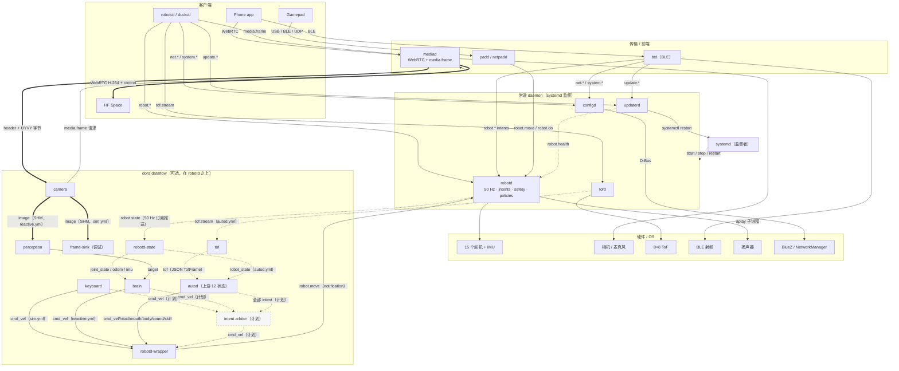
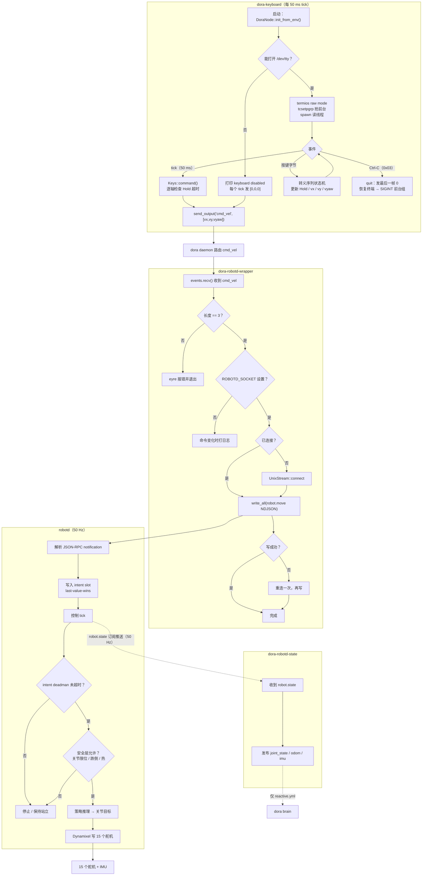
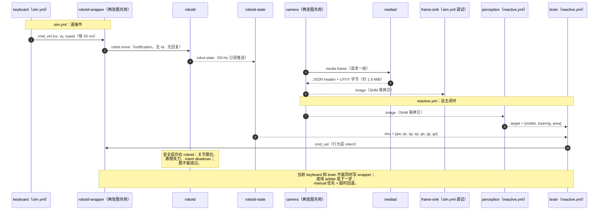

# 鸭子的调用关系

> 这张图回答“谁调用谁、用什么方式调用”。它把上游 Microduck 的既有调用关系与 dora 数据流
> 叠在一起看，**不改变 `robotd` 的权威边界**：所有进入 `robotd` 的箭头都是 intent，没有
> 任何一条能直接写舵机。
>
> 配套阅读：`docs/architecture.md` §2（上游架构）与 §3（dora 插入点）。

## 1. 总览（组件关系）

图例：

- 实线箭头：请求/响应（JSON-RPC call，可能有回复）。
- 虚线箭头：通知/订阅推送（server → client，不需要回复）；带“计划”标签的是尚未实现的
  arbiter 路径。
- 粗箭头：大块数据（相机帧、WebRTC、共享内存）。
- 虚线框节点：计划中的 dora 节点（目前只有 intent arbiter）。

读法：

- 左边是客户端，中间是传输/daemon，下面是硬件。
- `robotd` 是唯一通向舵机的箭头；`btd`、`padd`、`robotctl`、dora 的 wrapper 都只是 intent
  的发送方。
- `mediad` 同时是相机所有者（`camhw`）和两个数据出口：WebRTC（给人/远端）和
  `media.frame`（给本机 perception）。
- `tofd` 单独拥有 ToF，不经过 `robotd`。
- `configd` / `updaterd` / `btd` 是恢复路径：它们不依赖 `robotd`，`robotd` 死了也要能工作。
- dora 有**三条互斥**的当前控制链：`sim.yml` 的 `keyboard → wrapper`、`reactive.yml` 的
  `camera → perception → brain → wrapper`，以及 `autod.yml` 的
  `robotd-state → autod ← tof → wrapper`。三张图不要同时跑；虚线框的 intent arbiter 是
  合并它们之前要补的仲裁层。
- `autod` 现在和另外两条链一样走 dora topic；只有 source/sink 节点还开 socket：
  `robotd-state` 读 `robotd`、`tof` 读 `tofd`、`wrapper` 写 `robotd`。
- `state`、`camera`、`perception`、`brain`、`autod`、`tof` 都是当前实现。

## 2. 调用流程（当前真实路径）

如果只读一张图，读这张。它按**调用顺序**画：矩形是处理步骤，菱形是分支，虚线是订阅推送。
`X` 键和单独的 Esc 在 `K7` 的状态机里处理；`Ctrl-C` 单独画出来，因为它会恢复终端并停掉整个
数据流。

图里没有画出来、但在同一层发生的三件事：

- `dora-mujoco-bridge` 仍是确定性合成步态的独立 stub，已不在 `sim.yml` 中；`sim.yml` 的
  `joint_state` 来自 `robotd-state` 的真实 `robot.state` 订阅。键盘节点和 wrapper 之间的
  `cmd_vel` 是 Arrow `f32[3]`，每 50 ms 一条；dora 的 daemon/zenoh 负责路由，不改变命令语义。
- 相机路径在 `sim.yml` 是 `mediad → camera → image → frame-sink`，在 `reactive.yml` 是
  `mediad → camera → image → perception → brain`，都不经过 `robotd`，也不在上面这张键盘
  流程图里。`frame-sink` 是调试消费者；`perception` 是真实消费者，两者属于不同的图。
- `autod.yml` 是第三条独立链：`robotd-state ──robot_state──▶ autod`、`tof ──tof──▶ autod`、
  `autod ──intents──▶ wrapper`。source/sink 节点仍开 socket，但 `autod` 本身完全走 dora。

## 3. 两条控制链的时序

键盘链在 `sim.yml`，感知链在 `reactive.yml`；两张图不能同时跑，因为都直接写 wrapper 的
`cmd_vel`。虚线框的 arbiter 是合并它们之前要补的层。

时序里的关键点：

- `robot.move` 是 **notification**：没有 `id`，没有回复，发出去就结束。`robotd` 的安全层
  决定是否执行。
- `robot.state` 是 **订阅推送**：连接建立后 `robotd` 按 50 Hz 推（可用 `hz` 降频），不是
  客户端轮询。
- `media.frame` 是 **按需拉取**：请求登记后等下一帧，不是读缓存；默认 720p30 一帧约
  1.8 MiB（仿真 `360p30` 约 460 KB），JSON 头之后紧跟原始 UYVY 字节。**一个连接只返回
  一帧**，所以 `camera` 每个 tick 都会重连，只打印首连和恢复。
- 大帧进入 dora 图后走 SHM（≥4096 B、同机、池子有空间）。`camera` 用
  `allocate_data_sample` + `encode_uint8_ipc_header` + `send_output_sample` 把二进制尾部
  直接读进 sample，效果等同于 `send_output_raw` 的 0 拷贝路径；接收端 `values()` 直接
  alias 那块内存。`send_output`（Arrow 数组）则是 1 拷贝。
- `autod.yml` 不在这张时序里：`robotd-state → robot_state → autod`、`tof → tof → autod`，
  `autod` 再把 `cmd_vel/head/mouth/body/sound/skill` 发给 `wrapper`。source/sink 仍走
  socket，但 `autod` 本身是普通 dora 节点。

## 4. 调用关系表

| 调用方 | 被调用方 | 方法 / 数据 | 类型 |
|---|---|---|---|
| Phone app | `btd` | BLE GATT → 路由后的 `robot.*` / `net.*` / `update.*` | transport |
| Phone app | `mediad` | WebRTC 媒体 + control datachannel | 双向数据 |
| Gamepad | `padd` / `netpadd` | `robot.move` / `robot.do` 等 | intent |
| `robotctl` / `duckctl` | `robotd` | `robot.move`、`robot.state`、`robot.health`、`robot.subscribe`… | 请求/响应 + 订阅 |
| `robotctl` | `configd` | `net.*`、`system.*` | 请求/响应 |
| `robotctl` | `updaterd` | `update.*`、进度通知 | 请求/响应 + 订阅 |
| `robotctl` | `tofd` | `tof.stream` | 订阅 |
| `robotctl` | `mediad` | `media.frame` | 请求 + 二进制 |
| `btd` | `robotd` | 路由后的 `robot.*` intents | transport |
| `btd` | `configd` / `updaterd` | `net.*` / `system.*` / `update.*` | transport |
| `padd` | `robotd` | `robot.move` 等 intents | notification |
| `mediad` | `robotd` | 状态/配置查询 | 请求/响应 |
| dora `keyboard`（sim.yml） | `robotd-wrapper` | `cmd_vel` Arrow `f32[3]` | dora 消息 |
| dora `robotd-wrapper` | `robotd` | `robot.move` | notification |
| `robotd` | dora `robotd-state` | `robot.state` | 订阅推送 |
| dora `camera` | `mediad` | `media.frame` | 请求 + 二进制 |
| dora `camera`（sim.yml） | dora `frame-sink`（调试） | `image`（原始字节） | dora 消息（SHM） |
| dora `camera`（reactive.yml） | dora `perception` | `image`（原始字节） | dora 消息（SHM） |
| dora `perception` | dora `brain` | `target = [visible, bearing, area]` | dora 消息 |
| dora `robotd-state` | dora `brain` | `imu = [qw, qx, qy, qz, gx, gy, gz]` | dora 消息 |
| dora `brain`（reactive.yml） | `robotd-wrapper` | `cmd_vel` | dora 消息 |
| dora `autod`（autod.yml） | dora `robotd-wrapper` | `cmd_vel` / `head` / `mouth` / `body` / `sound` / `skill` | dora 消息 |
| dora `robotd-state` | dora `autod` | `robot_state`（JSON） | dora 消息 |
| dora `tof` | dora `autod` | `tof`（JSON `TofFrame`） | dora 消息 |
| `tofd` | dora `tof` | `tof.stream` → `tof.frame` | socket 订阅 |
| dora `robotd-wrapper` | `robotd` | `robot.move/head/mouth/pose/sound/do` | notification/request |
| dora `keyboard` / `brain`（计划） | `intent arbiter` | `cmd_vel`（manual / auto） | dora 消息（计划） |
| `intent arbiter`（计划） | `robotd-wrapper` | `cmd_vel` | dora 消息（计划） |
| `updaterd` | `robotd` | `robot.health` | 请求/响应 |
| `updaterd` | `systemd` | `systemctl restart` | 进程控制 |
| `systemd` | 所有 daemon | start / stop / restart / watchdog | 监督 |
| `robotd` | 舵机总线 + IMU | Dynamixel 协议 | 硬件 |
| `mediad` | 相机 / 麦克风 | V4L2 / GStreamer | 硬件 |
| `tofd` | ToF | I²C / SPI | 硬件 |
| `configd` | BlueZ / NetworkManager | D-Bus | OS |

## 5. 边界说明

- **所有进入 `robotd` 的箭头都是 intent。** 没有任何客户端、transport、dora 节点能直接写
  舵机；`robotd` 内部的安全层（关节限位、跌倒失力、intent deadman）是最后一道门。
- **`robotd` 的控制环不等待任何调用方。** 它读的是 last-value-wins 缓存；一个卡住的
  `mediad` 或 dora 节点只会让感知退化，不会给电机控制加抖动。
- **dora 的 coordinator 不在数据路径上。** 它只负责 start/stop/restart/logs；节点之间的
  Arrow/SHM 不经过它。数据面的大帧更不经过它。
- **dora 是可选的。** 去掉 dora，上游的调用关系照常工作：`robotctl`、`padd`、`btd`、
  `mediad` 仍然能驱动和观察鸭子。
- **恢复路径不能被 dora 依赖。** `configd`、`updaterd`、`btd` 在 `robotd` 死掉时仍要工作；
  dora 挂在它们上面会把恢复路径变成“先有 dora 才能修机器人”。
- **跨机不共享内存。** `media.frame` 和 dora 的 SHM 都是同机路径；跨机走 WebRTC/网络。
- **`sim.yml`、`reactive.yml` 和 `autod.yml` 互斥。** 键盘、reactive brain 和 autod 都写
  intent，同时运行是 last-writer-wins；arbiter 落地之前，手动接管要先停掉另外两张图。
- **autod 自己不再开 socket。** `robotd-state`/`tof` 是 source，`wrapper` 是 sink；
  `autod` 只消费/发布 dora topic。
- **`brain` 不是安全层。** 它会在倾角/IMU 超时/目标丢失时发零，但真正的关节限位、跌倒
  失力和 deadman 仍在 `robotd`。
